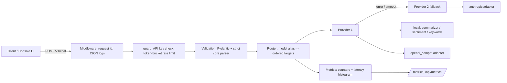

# Architecture

Author: Rayyan Anwar

## Request flow
1. Middleware assigns a sanitised `X-Request-ID` (or generates one) and logs one JSON line per request (never the API key).
2. `guard` authenticates (`Authorization: Bearer` or `X-API-Key`, constant-time comparison) **before** body validation, then applies a per-client token bucket (client id = hash of key, or client IP when auth is off). Success responses carry `X-RateLimit-*`; rejections return 429 with `Retry-After`.
3. The body is validated (Pydantic for OpenAPI/422 shape, then the framework-independent `parse_chat_request` as the authoritative check).
4. The router looks up the alias and tries targets in order. Each attempt is bounded by `GATEWAY_REQUEST_TIMEOUT_S` (`asyncio.wait_for` plus a socket timeout). Timeouts, upstream errors, malformed responses and unconfigured providers move on to the next target.
5. Result: 200 with provider, upstream model, usage (flagged `estimated` when the upstream did not report it), attempts and `fallback_used`; or 404 unknown alias, 502 all failed, 503 nothing configured, 504 all timed out.

## Design notes
- `app/gateway.py` has no web-framework imports, so routing, fallback, timeout and metrics logic is unit-tested without a server.
- Remote adapters use the standard library in worker threads: no extra dependencies, and tested against a local fake upstream server.
- Route configuration is operator-controlled (trusted); user input never chooses a URL.
- State (rate-limit buckets, metrics) is in memory and per process.
